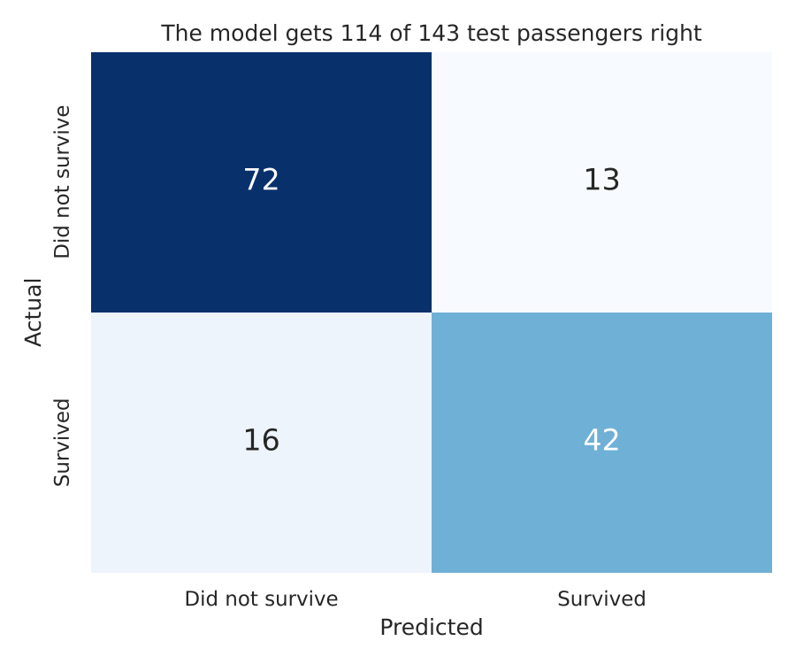
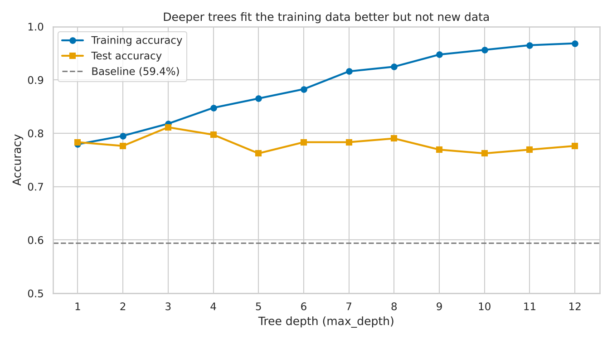

# First Machine Learning Classifier: Titanic Survival

**Project 04 | Data Science & AI | InternCircle**

A decision tree built with scikit-learn that predicts whether a Titanic passenger survived from their ticket class, sex, age and fare. The model is tested on data it has not seen and compared with a simple baseline.

## Results
| Measure | Value |
|---|---|
| Baseline (always guess "did not survive") | 59.4% |
| **Test accuracy (decision tree, depth 4)** | **79.7%** |
| Precision / recall for survivors | 0.76 / 0.72 |

- Sex is the most important feature (0.55), then ticket class (0.24).
- Very deep trees overfit: 96.8% training accuracy but only 77.6% test accuracy at depth 12.




## What is in the notebook
1. Prediction defined in one sentence
2. Data preparation (missing values, sex as 0/1)
3. Train/test split (80/20, stratified, `random_state=42`)
4. Baseline
5. Decision tree training (`max_depth=4`)
6. Evaluation: accuracy, confusion matrix, precision, recall, MSE
7. Depth 1 to 12 overfitting test, plus 5-fold cross-validation
8. Feature importance and the tree diagram
9. What I learned and limitations

## Files
- `Titanic_ML_Classifier.ipynb`: full notebook
- `Titanic_ML_Classifier.html`: notebook as a web page
- `Results_Writeup.md`: short write-up of results and limitations
- PNG files: confusion matrix, depth chart, feature importance, tree diagram

## Run it yourself
```
pip install jupyter pandas numpy matplotlib seaborn scikit-learn
jupyter notebook Titanic_ML_Classifier.ipynb
```
Or upload the notebook to Google Colab and choose Runtime > Run all.

## Limitations
Small dataset (143 test passengers), 177 rows dropped for missing age, only four features, and 28% of survivors are missed. The model finds patterns, not causes.

**Author:** Your Name
